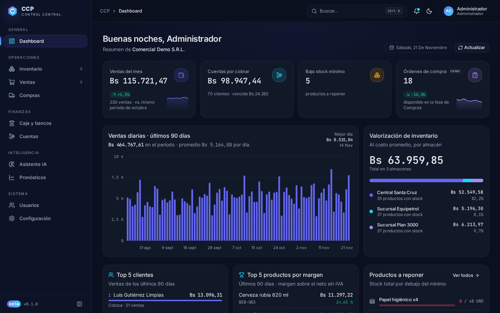
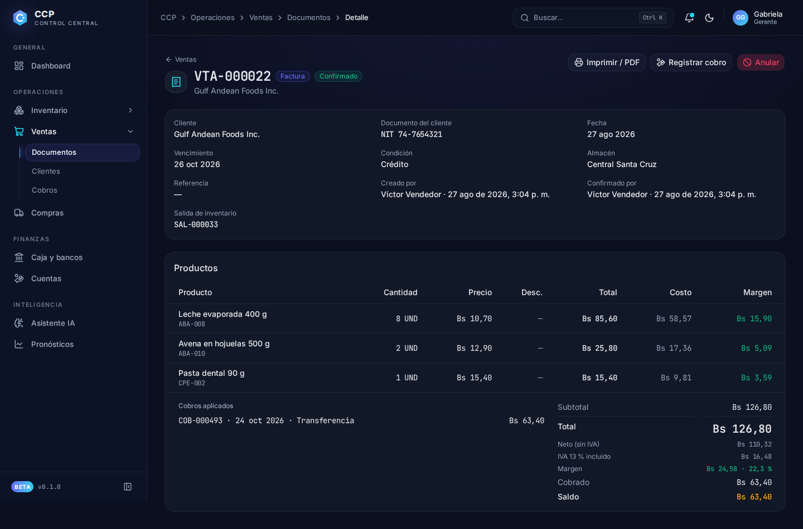
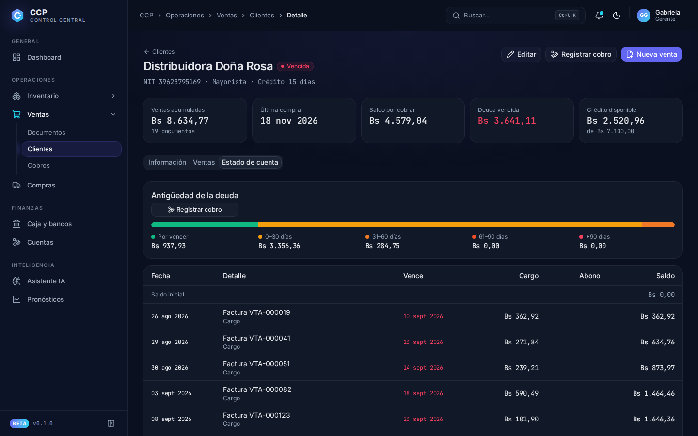
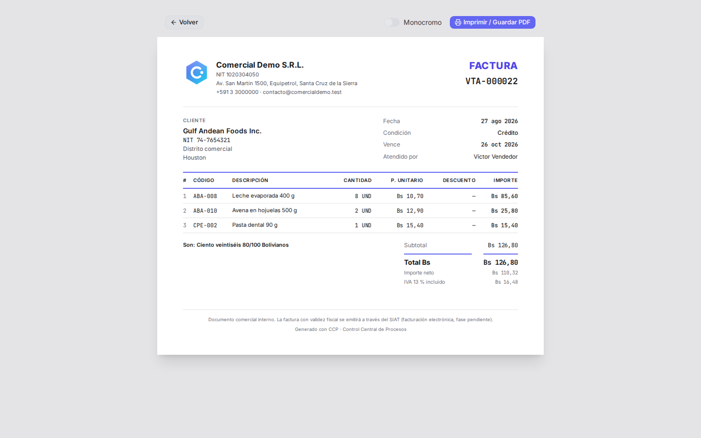

<p align="center">
  
</p>

<h1 align="center">CCP — Control Central de Procesos</h1>

<p align="center"><strong>Tu empresa, bajo control.</strong><br/>
ERP web para pymes: inventario, ventas, compras, finanzas e inteligencia de negocio.</p>

<p align="center">
  <a href="https://github.com/Cristian-Claure/ERP-CCP/actions/workflows/ci.yml"></a>
  
  
  
  
  
</p>

---

## Capturas

| Dashboard | Venta con margen y cobros |
|---|---|
|  |  |
| **Estado de cuenta del cliente** | **Documento imprimible (PDF)** |
|  |  |

## Stack

| Capa | Tecnología |
|---|---|
| API | Laravel 13 · PHP 8.5 · PostgreSQL 18 · Redis 8 · Sanctum (SPA, cookies) · spatie/laravel-permission · Pest |
| Web | React 19 · TypeScript · Vite 8 · Tailwind CSS v4 · shadcn/ui · TanStack Query · React Router · Zustand · React Hook Form + Zod · Recharts · Vitest |
| IA | Python 3.12 · FastAPI · Pydantic v2 · uv · Ruff · pytest |
| Infra | Docker Compose · nginx · Mailpit · GitHub Actions |

## Arranque rápido

Requisitos: Docker Desktop (o Docker Engine + Compose v2), GNU Make y Git. **No** hace falta PHP,
Composer ni Python en el host.

> **Windows:** ejecuta los comandos `make` desde **PowerShell**. En Git Bash, la conversión automática
> de rutas de MSYS rompe los volúmenes de Docker (`-w /app` se convierte en `C:/Program Files/Git/app`);
> si usas Git Bash, antepón `MSYS_NO_PATHCONV=1` (por ejemplo `MSYS_NO_PATHCONV=1 make up`).

```bash
git clone https://github.com/Cristian-Claure/ERP-CCP.git
cd ERP-CCP
make up      # crea .env con secretos aleatorios, construye y levanta todo
make fresh   # migra y carga datos demo
```

| | URL |
|---|---|
| Aplicación | http://localhost:5173 |
| API | http://localhost:8000/api/v1 · health: `/api/v1/health` |
| Docs del servicio IA (solo dev) | http://localhost:8001/docs |
| Mailpit | http://localhost:8025 |

**Usuario demo:** `admin@ccp.test` / `password` (también `gerente@`, `vendedor@` y
`almacenero@ccp.test` con la misma contraseña), en la empresa *Comercial Demo S.R.L.*

### Comandos

```bash
make test     # Pest + pytest + Vitest
make lint     # Pint + Ruff + ESLint, tsc y Prettier
make format   # autoformatea todo
make logs     # logs en vivo
make down     # detiene los contenedores
```

## Estructura

```
apps/api    API Laravel (gateway único)
apps/web    SPA React
apps/ai     Servicio interno de IA (FastAPI)
docker/     Dockerfiles y configuración
docs/       Arquitectura y ADRs
```

Más detalle en [`docs/architecture.md`](docs/architecture.md) y
[`docs/adr/0001-arquitectura-monorepo.md`](docs/adr/0001-arquitectura-monorepo.md).
Convenciones y reglas de base de datos en [`CLAUDE.md`](CLAUDE.md).

## Roadmap

- [x] **Fase 0 — Cimientos:** monorepo, Docker, auth Sanctum, multiempresa (roles por empresa), health, servicio IA, AppShell y dashboard
- [x] **Fase 1 — Inventario:** productos, almacenes, ledger de movimientos, costo promedio, kardex con CSV, ajustes por conteo, anulaciones, numeración sin huecos, `inventory:verify` y DataTable reutilizable
- [x] **Fase 2 — Ventas** ([ADR 0005](docs/adr/0005-ventas-impuestos-y-cuentas-por-cobrar.md)): clientes con ubicación, cotizaciones, facturas y notas de venta con salida de stock atómica (SAL- enlazado), IVA incluido desglosado, margen por línea, autorizaciones bajo costo y sobre límite de crédito, cobros, cuentas por cobrar con antigüedad, `customers:verify`, documento imprimible y dashboard con datos reales
- [x] **Fase 2 · CCP Atlas** ([docs/frontend/atlas.md](docs/frontend/atlas.md)): globo 3D a medida (React Three Fiber + shaders propios) con el sol real, columnas de clientes por ventas y estado de cobro, clustering, arcos almacén → cliente, hexbins, tour y vista 2D sin WebGL
- [ ] **Fase 2 · POS** — pantalla de mostrador
- [ ] **Fase 3 — Compras:** proveedores, órdenes, recepciones con entrada a stock
- [ ] **Fase 4 — Finanzas:** caja y bancos, cuentas por cobrar y por pagar
- [ ] **Fase 5 — Inteligencia:** pronósticos de demanda reales y asistente IA sobre los datos de la empresa
- [ ] **Fase 6 — Sistema:** gestión de usuarios y roles, configuración de empresa, auditoría visible

## Software libre

Solo dependencias con licencia aprobada por la OSI y datos abiertos: ver
[`docs/LICENSES.md`](docs/LICENSES.md) y [`docs/CREDITS.md`](docs/CREDITS.md).

## Licencia

Propietario. Todos los derechos reservados.
