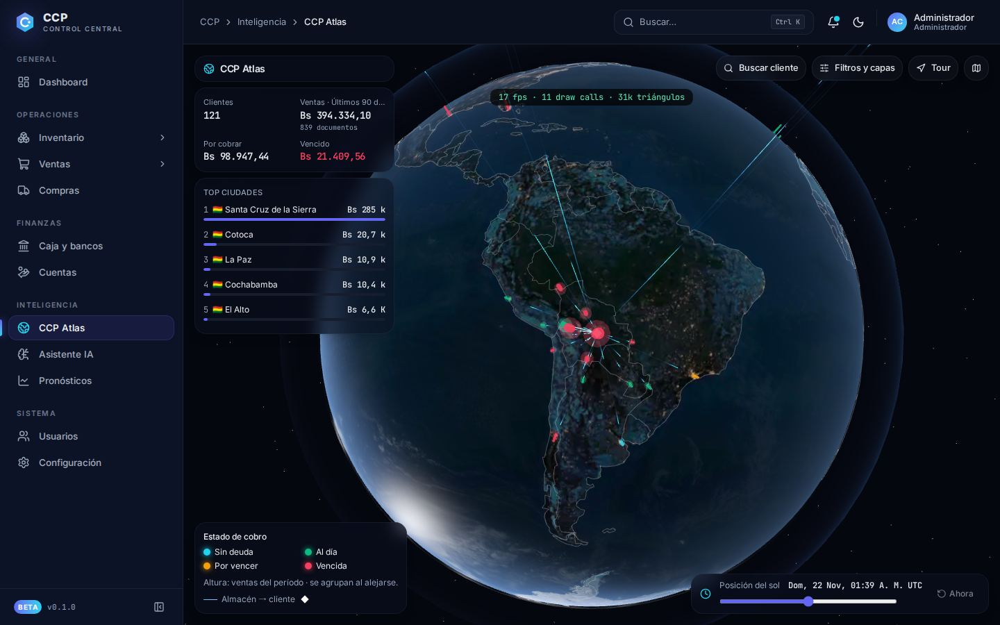
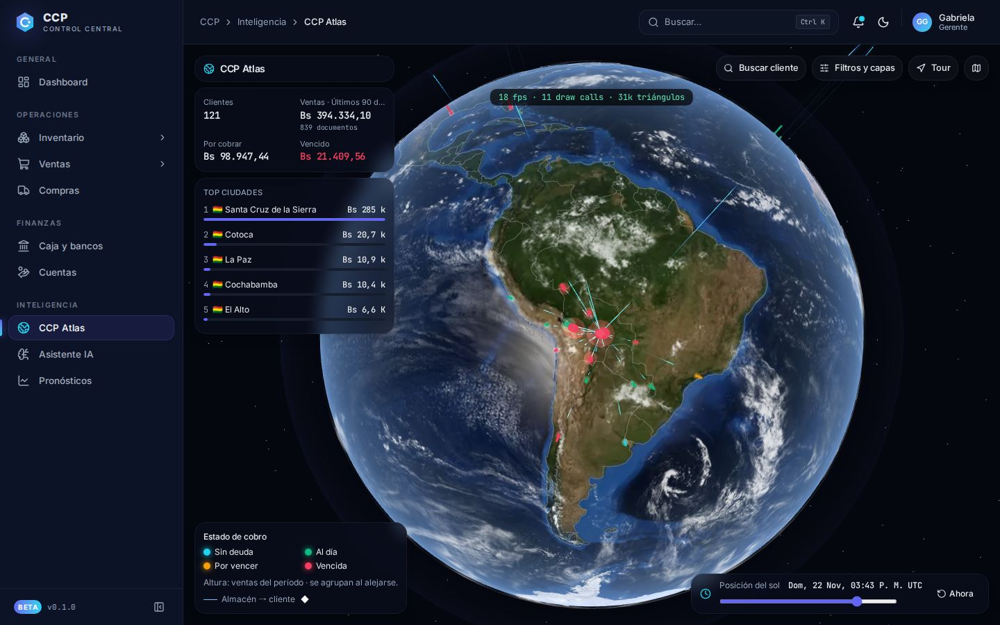
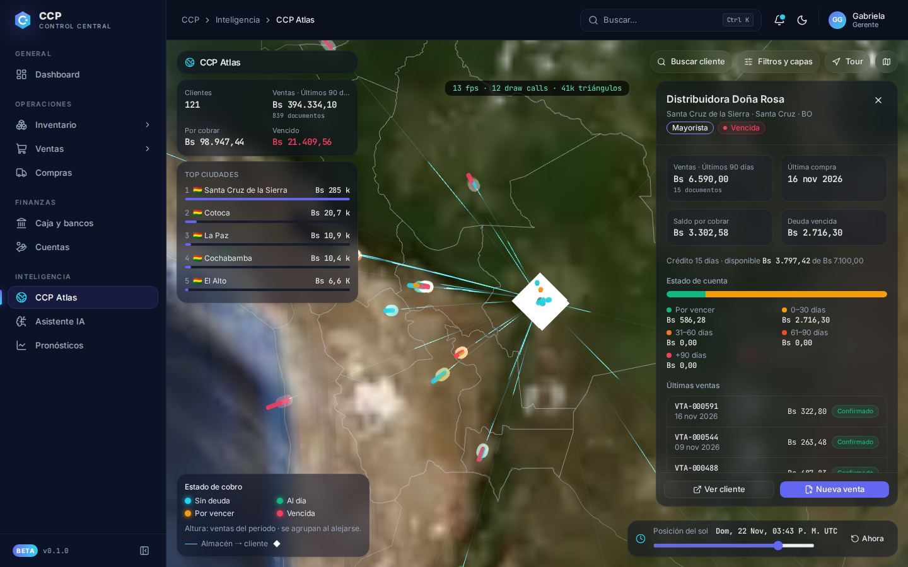
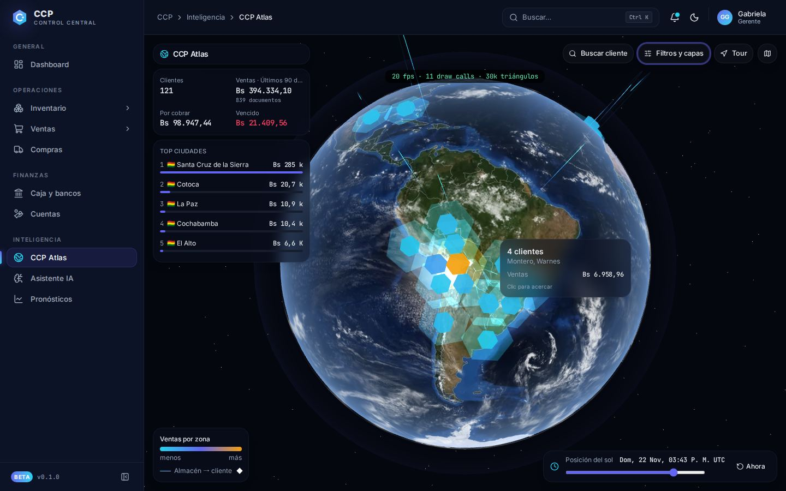
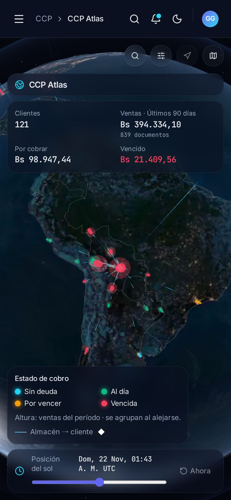
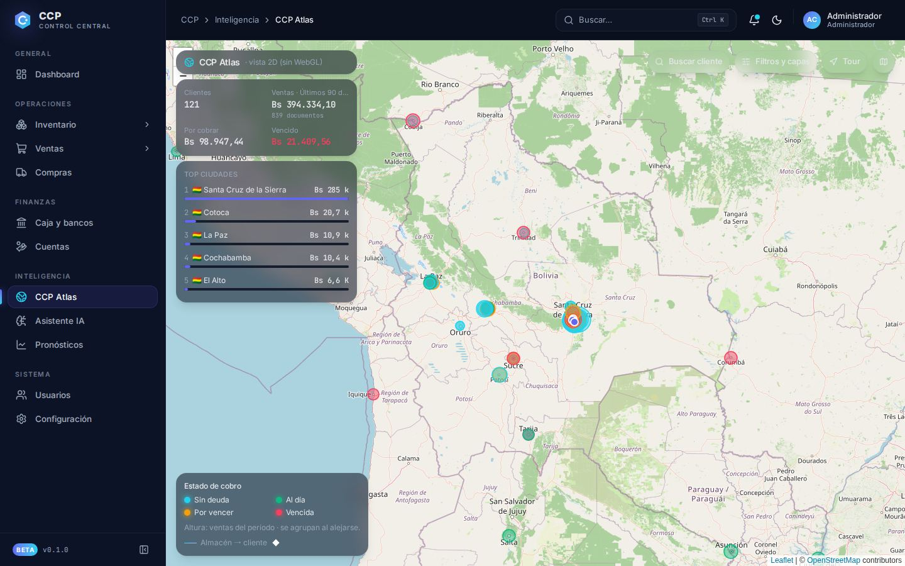

# CCP Atlas — globo 3D de clientes

Ruta `/atlas` (sidebar → Inteligencia, permiso `customers.view`). Muestra dónde están los clientes,
cuánto compran y cómo pagan, sobre una Tierra con la iluminación real del momento.

| De noche (hora real) | De día (control de tiempo +14 h) |
|---|---|
|  |  |
| **Cliente seleccionado** | **Modo hexágonos** |
|  |  |
| **Móvil (reduced motion)** | **Sin WebGL: vista 2D** |
|  |  |

## Decisión: a medida (React Three Fiber) en lugar de globe.gl

globe.gl resuelve rápido puntos y arcos, pero trae su propio loop, cámara y materiales. Lo que pedía
Atlas exige controlar el pipeline:

- shader de Tierra con mezcla día/noche según el **sol real**;
- océanos especulares, relieve, nubes y atmósfera;
- clustering propio;
- *dispose* explícito;
- integración con React, TanStack Query y el design system.

Con globe.gl habría que pelear con su API. A medida son ~15 módulos pequeños. Dependencias: `three` y
`@react-three/fiber` (MIT), `topojson-client` (ISC). **No se usa drei**: `OrbitControls` sale de
`three/addons`, para mantener pequeño el árbol de dependencias.

## Arquitectura

```
features/atlas/
  api.ts            useAtlasCustomers / useAtlasWarehouses (TanStack Query)
  store.ts          estado de UI (Zustand): filtros, modo, capas, selección, vuelo, tour, hover, perf
  lib/              lógica pura y testeada
    geo.ts          lat/lng ↔ Vector3 (alineado con los UV de SphereGeometry), arcos de círculo máximo
    sun.ts          punto subsolar desde la hora UTC (declinación + ecuación del tiempo)
    cluster.ts      clustering por grilla de área ~igual según la distancia de cámara; hexbins axiales
    borders.ts      TopoJSON/GeoJSON → LineSegments sobre la esfera; point-in-polygon
    data.ts colors.ts device.ts periods.ts
  shaders/*.glsl    Tierra, nubes, atmósfera, arcos (archivos propios, importados con ?raw)
  scene/            AtlasScene (Canvas, lazy) · Earth · Stars · CustomerLayers + InstancedBars
                    · Arcs · Borders · CameraRig · PerfMeter · useAtlasTextures
  ui/               HUD · Toolbar · Legend · TimeControl · HoverTooltip · CustomerPanel
                    · LoadingOverlay · AtlasFallback2D
  pages/AtlasPage.tsx
```

### Backend

- `GET /api/v1/atlas/customers?period=30d|90d|365d|ytd|all&segment=&status=` devuelve, por cliente
  geolocalizado:
  - ventas del período, número de documentos y última compra;
  - `flows` por almacén (origen de los arcos);
  - con `receivables.view`: saldo, deuda vencida y estado de cobro.
- **Sin** `receivables.view`, esos campos no se envían y el filtro de deuda se ignora. En el globo, el
  color pasa a representar el **segmento** y los filtros de deuda se ocultan.
- `GET /api/v1/atlas/warehouses`: almacenes con coordenadas.
- Caché en Redis por empresa y filtros, con **versión por empresa** en la clave
  (`atlas:{empresa}:v{n}:…`). `InvalidateAtlasCache` incrementa la versión con `SalesDocumentPosted`,
  `SalesDocumentVoided`, `PaymentRegistered`, `PaymentVoided` y `CustomerSaved`, todos *after commit*.
  Así se invalidan todas las combinaciones de filtros sin *tags* ni escaneos de claves.

### Escena

| Capa | Técnica | Draw calls |
|---|---|---|
| Tierra | `ShaderMaterial` propio. Mezcla día/noche con `smoothstep(dot(N, sol))`, luces de ciudad cálidas en la noche, reflejo del sol enmascarado a océanos, *bump* por derivadas de pantalla y halo *fresnel* | 1 |
| Nubes | Esfera propia, densidad desde textura, iluminada por el sol, rotación propia | 1 |
| Atmósfera | Cáscara *BackSide* aditiva, *fresnel* más brillante del lado diurno | 1 |
| Estrellas | `Points` deterministas (PRNG con semilla) | 1 |
| Columnas / hexágonos | `InstancedMesh`, más un halo aditivo instanciado | 2 |
| Arcos | **Una** geometría `LineSegments` con todos los arcos (top 220 flujos); las partículas son un shader (`progress`, `seed`, `time`) | 1 |
| Fronteras | `LineSegments`: 110m lejos, 50m cerca, departamentos de Bolivia muy cerca (carga *lazy*). Al pasar el cursor, se resalta el país o departamento (*picking* con *throttle* de 80 ms sobre una esfera invisible) | 1–3 |
| Almacenes | Octaedros | 3 |

- **Sol real:** `sunDirection(now + offset)` se recalcula cada segundo. El control de tiempo mueve ±24 h.
- **Clustering:** la distancia de cámara se publica en pasos de 0,05. La celda pasa de 6° (lejos) a
  0 (cerca, sin agrupar). Los centroides se calculan sobre vectores unitarios: correctos en el
  antimeridiano y cerca de los polos.
- **Tamaño según el zoom:** columnas, hexágonos y marcadores se escalan con la distancia; de lo
  contrario, la cámara quedaría dentro de las columnas al mirar un barrio.
- **Interacción:**
  - órbita y zoom con mouse y táctil;
  - tooltip al pasar el cursor;
  - clic: vuelo suave y panel lateral; en un grupo, acerca la cámara;
  - buscador con vuelo y ranking de ciudades clicable;
  - tour por las zonas de más ventas;
  - autorrotación tras 7 s de inactividad.
- **`prefers-reduced-motion`:** sin autorrotación, sin tour (el botón queda deshabilitado), sin
  partículas en movimiento, sin rotación de nubes y con vuelos instantáneos.

### Texturas y carga

- Día y noche en **4K o 2K** según el dispositivo (`pickTextureQuality`):
  - 4K solo con puntero fino, ≥4 GB de memoria, `MAX_TEXTURE_SIZE ≥ 4096` y pantalla grande o densa;
  - los móviles siempre reciben 2K.
- Especular, relieve y nubes solo en 2K.
- Formato WebP: 1,6 MB de texturas más 0,9 MB de geodatos en total. Origen y licencias en
  [`docs/CREDITS.md`](../CREDITS.md); se regeneran con `docs/scripts/atlas_assets.py`.
- La ruta y la escena son *lazy*. three.js va en su propio chunk (`AtlasScene`: 960 kB, 255 kB gzip)
  y no entra en el bundle principal.
- `LoadingManager` reporta el **progreso real** de las texturas a la pantalla de carga.
- **Dispose:** materiales, geometrías, texturas y `OrbitControls` se liberan explícitamente al
  desmontar. Verificado navegando fuera y de vuelta, sin errores.

### Sin WebGL

Si no hay contexto WebGL, `AtlasFallback2D` muestra los mismos datos en Leaflet + OpenStreetMap:

- círculos con área proporcional a las ventas y mismo criterio de color;
- clic para seleccionar el cliente.

La vista 2D también está disponible bajo demanda con el botón de mapa.

## Rendimiento

Para medir, abre `/atlas?perf=1`: se muestran fps, *draw calls* y triángulos, actualizados una vez por
segundo.

| Escenario | fps | Draw calls | Triángulos |
|---|---|---|---|
| Vista continental, columnas + arcos + fronteras | — (GPU real: pendiente) | 11 | ~31k |
| Cliente seleccionado (zoom cercano, fronteras 50m) | — | 12 | ~41k |
| Modo hexágonos | — | 11 | ~30k |
| **Medido en el entorno de desarrollo**: Chromium *headless* con SwiftShader (render **por software**, sin GPU), 1440×900 | 13–20 | | |

El entorno de desarrollo de esta fase no tenía GPU: la única medición posible fue con SwiftShader,
que renderiza todo en CPU y es una **cota inferior** muy pesimista.

El diseño apunta a ≥50 fps en una laptop media:

- presupuesto de ≤15 *draw calls* y <60k triángulos;
- instancing y geometrías fusionadas;
- `dpr` limitado a 1,75;
- sin post-procesado.

**Pendiente: validar con `?perf=1` en hardware real** (laptop con GPU integrada) y registrar el resultado
en esta tabla.

## Tests

- **Vitest** (`lib/lib.test.ts`):
  - lat/lng → Vector3 contra los vértices y UV de `SphereGeometry`, ida y vuelta, distancia y arcos;
  - posición solar: solsticios, equinoccios y ecuación del tiempo de febrero y noviembre;
  - clustering: agrupar y separar, antimeridiano y hexbins.
- **Pest** (`tests/Feature/Atlas/AtlasEndpointTest.php`):
  - permisos `customers.view` y `receivables.view`;
  - filtros de período, segmento y estado;
  - aislamiento entre empresas;
  - caché servida y luego invalidada por cada evento.
